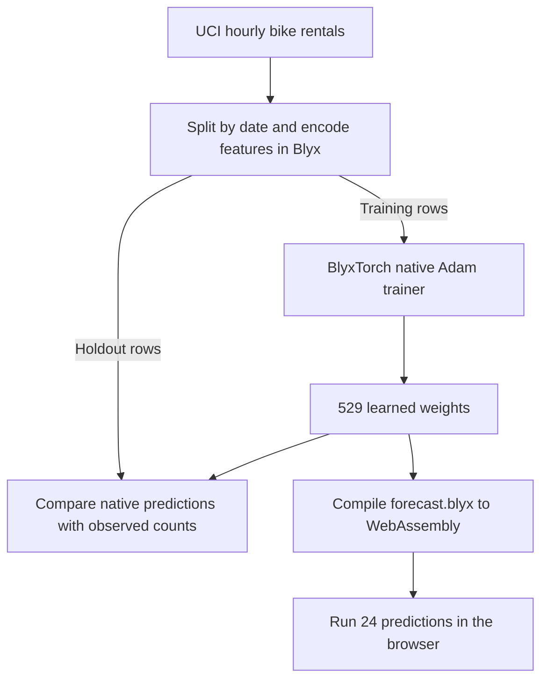

# SpokeCast

SpokeCast estimates how many Capital Bikeshare trips riders would take in each hour of a day in Washington, D.C. Choose a month, day type, weather and temperature. The planner shows the 24 hourly estimates, the daily total and the busiest hour, with an accessible table and a CSV export.

The model learns from **2011–2012 system-wide rental counts**. All scenarios use the size of the network in 2012. Use the planner to explore historical patterns. For example, the summer workday preset estimates **6,962 trips**, with **774 trips from 17:00 to 18:00** local time. [Open SpokeCast on Vercel](https://spokecast-blyxtorch.vercel.app)

## Run it locally

Only a static web server and a browser with WebAssembly support are required to run the committed app. The model, fonts and photograph are included.

```sh
git clone https://github.com/Rahulchaube1/spokecast-blyxtorch.git
cd spokecast-blyxtorch
python3 -m http.server 8000 --directory dist
```

Open the forecast, change a setting and select **Run forecast**. **Export CSV** downloads 24 rows with the local hour, estimated rides, scenario inputs and network year. [Local app](http://localhost:8000)

## How it was built



1. **Prepare the data.** The training script downloads the UCI archive, verifies the SHA-256 of `hour.csv` and drops three severe-weather observations. It divides the remaining records by date and shuffles the training rows once with seed 19. The output to predict is `cnt`, the total hourly rentals. The casual and registered count columns are excluded because they sum to the target. [Data preparation](scripts/train.py)
2. **Encode each hour.** One Blyx feature function serves both training and prediction. Its 31 numbers encode the hour (24 indicators), month (sine and cosine), workday, mist, light rain/snow, normalized temperature and study year. A workday excludes weekends and holidays. The hourly temperature uses the UCI range of −8 to 39 °C. [Feature code](model/features.blyx) · [Training CSV encoder](model/prepare.blyx)
3. **Generate and fit the network.** BlyxTorch 0.2.0 generates a dense network with 31 inputs, 16 ReLU hidden units and one linear output. The target is divided by 1,000 during training. Adam minimizes mean squared error for 35 epochs with learning rate 0.003, batch size 64 and seed 19. The native Blyx program performs the fitting. Python orchestrates the commands and computes evaluation statistics. [Generated trainer and network](model/network.blyx) · [Fitted checkpoint](model/spokecast.bt)
4. **Compile the trained model for the web.** The build script feeds the Blyx compiler’s Rust output to the WebAssembly target and adds one scalar export named `predict`. The Blyx `estimate` function validates the inputs, calls `bt_predict` with the learned weights, restores the original unit and clips negative estimates to zero. [Blyx inference](model/forecast.blyx) · [Compiled weights](model/checkpoint.blyx) · [Build adapter](scripts/build_wasm.py)
5. **Build the planner.** The page loads the WebAssembly model and calls it once per hour with the selected scenario. It rounds each hourly estimate to a whole ride before computing the daily total, peak and CSV. All inference runs on the visitor’s device. [Interface](dist/index.html) · [Application code](dist/app.js) · [WebAssembly model](dist/model.wasm)

## Experiment and results

The experiment asks whether the scenario features improve predictions over simple historical averages. All three predictors use the same chronology and the same held-out target. Both baselines use averages calculated exclusively from the training period.

| Split | Period | Eligible hourly observations |
| --- | --- | ---: |
| Training | 1 Jan 2011 – 31 Oct 2012 | 15,916 |
| Held-out test | 1 Nov 2012 – 31 Dec 2012 | 1,460 |

| Predictor | Mean absolute error (rides/hour) | Root mean squared error (rides/hour) | R² |
| --- | ---: | ---: | ---: |
| Overall training mean | 140.16 | 174.44 | ≈ 0.000 |
| Training mean for the same hour and day type | 63.51 | 98.05 | 0.684 |
| BlyxTorch network | **51.43** | **80.57** | **0.787** |

The neural network reduced mean absolute error by **19.0%** relative to the hour-and-day-type baseline. It was more accurate on the 957 workday hours (44.48 rides/hour mean absolute error) than on the 503 weekend or holiday hours (64.64). The 97 light-rain or snow hours had a mean absolute error of 62.39. Those smaller groups and the two-month test window limit how widely the results generalize. [Experiment code](scripts/experiments.py) · [Scores and group sizes](experiments/holdout.json) · [Full-precision release metrics](dist/metrics.json)

The app holds weather and temperature constant across a scenario. Current ridership levels, station inventories, and live or future weather are outside its scope. A daily total is the sum of the 24 scenario estimates. The reported test errors measure individual hours.

## Reproduce the experiment

The following steps use Linux or macOS. For the reference run, the toolchain was Blyx 0.2.1, BlyxTorch 0.2.0 and Rust 1.89.0. Install a C linker, Python 3.9+, Node.js 18+ and Rust's `rustup` tool. Download the Blyx compiler for your platform, verify its release checksum, extract it and place `blyxc` on PATH. You can also set `BLYXC` to the absolute path of the executable. [Blyx compiler downloads](https://www.blyx-lang.space/download) · [BlyxTorch release](https://github.com/Rahulchaube1/blyxtorch/releases/tag/v0.2.0) · [Rust installation](https://www.rust-lang.org/tools/install)

**1. Select the reference Rust toolchain and WebAssembly target.**

```sh
rustup toolchain install 1.89.0 --profile minimal --target wasm32-unknown-unknown
export RUSTUP_TOOLCHAIN=1.89.0
```

**2. Refit and evaluate.** The generated network source is checked in. The training command fetches the data and compiles the encoder and native BlyxTorch trainer.

```sh
python3 scripts/train.py
python3 scripts/experiments.py
```

You can supply the original ZIP with `python3 scripts/train.py --data /path/to/bike-sharing.zip`. Intermediate flat files, the native trainer and its held-out predictions go in `.build/`. The fitted checkpoint and its Blyx representation go in `model/`. The experiment writes its predictor comparison and subgroup results to `experiments/holdout.json`. [UCI dataset and download](https://doi.org/10.24432/C5W894)

**3. Build the browser model and verify it.**

```sh
python3 scripts/build_wasm.py
node scripts/verify.mjs
```

Verification checks 8,640 valid input combinations and rejects invalid inputs. After training, it also compares all 1,460 held-out WebAssembly predictions against the native predictions and independently recomputes mean absolute error. The observed maximum difference for this release was **0 rides**. [Verification code](scripts/verify.mjs)

**4. Run one native prediction.** With the compiler on PATH, the following example estimates an 08:00 June workday under clear skies at 24 °C. It returns about **658.08 rides** before UI rounding.

```sh
blyxc build model/forecast.blyx -o .build/forecast
.build/forecast
```

**5. Regenerate the downloadable project after editing.**

```sh
python3 scripts/package.py
python3 -m http.server 8000 --directory dist
```

To regenerate the network source itself, extract the official BlyxTorch release, keep its template files beside the executable and run the generator from the project root. The trained parameter layout matches this architecture.

```sh
blyxtorch emit 31,16,1 mse relu > model/network.blyx
```

## Deploy on Vercel

Import this repository in Vercel and select the repository root as the project directory. The committed Vercel configuration selects the **Other** preset, runs `node scripts/verify.mjs` and publishes `dist/`. The web build uses the checked-in model and requires no API keys. For a CLI deployment, authenticate the Vercel CLI and run the following from the project root. [Vercel configuration](vercel.json) · [Vercel Git deployments](https://vercel.com/docs/deployments/git)

```sh
vercel link
vercel deploy --prod
```

For a live check, open the Vercel URL in a signed-out browser, select **Summer commute**, and verify the 6,962 daily trips. Switch to **Weekend outing** to see 6,758 daily trips and a 14:00 peak. The table and CSV should contain the same 24 hourly values. [Production app](https://spokecast-blyxtorch.vercel.app)

## Sources and credits

- Hadi Fanaee-T, *Bike Sharing*, UCI Machine Learning Repository. The data is available under CC BY 4.0. [Dataset](https://doi.org/10.24432/C5W894) · [License](https://creativecommons.org/licenses/by/4.0/)
- Hadi Fanaee-T and João Gama, “Event labeling combining ensemble detectors and background knowledge,” 2013. [Paper](https://doi.org/10.1007/s13748-013-0040-3)
- The generated BlyxTorch source is included under the MIT option provided by Rahul Chaube and contributors. [BlyxTorch v0.2.0](https://github.com/Rahulchaube1/blyxtorch/tree/v0.2.0) · [License](model/BlyxTorch-LICENSE)
- The Capital Bikeshare photograph is by Tony Webster. It is resized and cropped for the banner under CC BY-SA 4.0. [Photo attribution and license](model/photo-credit.txt)
- DM Sans and Barlow Condensed use the SIL Open Font License. [DM Sans license](dist/assets/dm-sans-OFL.txt) · [Barlow Condensed license](dist/assets/barlow-condensed-OFL.txt)
