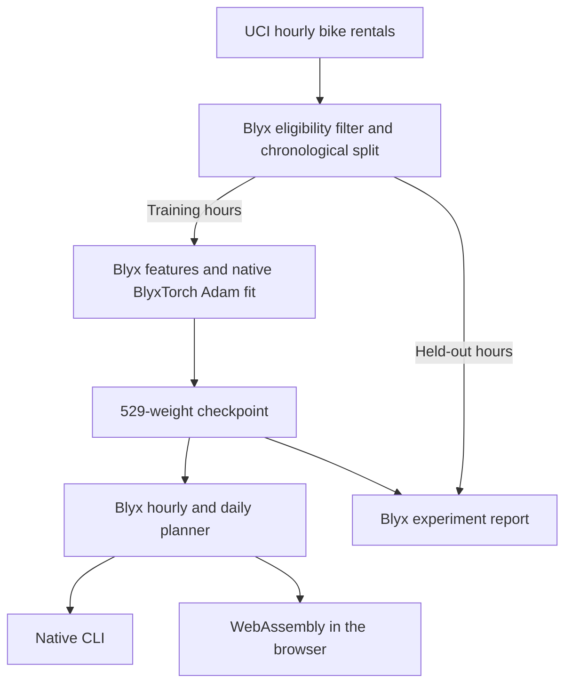

# SpokeCast

SpokeCast is a bike-share demand planner **written in Blyx with BlyxTorch**. The same Blyx program runs as a native command and as WebAssembly in the browser. It estimates each of the 24 hours of a day on Washington, D.C.’s historical Capital Bikeshare network. [Open the live app](https://spokecast-blyxtorch.vercel.app) · [Blyx entry point](main.blyx) · [Forecast logic](model/planner.blyx)

For a clear workday in June at 24 °C, the planner estimates **6,962 daily trips**, including **774 between 17:00 and 18:00**. Change the month, day type, weather or temperature to explore another scenario. All times are local to Washington, D.C.

## Run the Blyx program

Install Blyx 0.2.1, Rust and a host C linker. On Linux or macOS, use GNU Make from the repository root. The fitted model is included. [Blyx compiler downloads](https://www.blyx-lang.space/download) · [Rust installation](https://www.rust-lang.org/tools/install)

```sh
git clone https://github.com/Rahulchaube1/spokecast-blyxtorch.git
cd spokecast-blyxtorch
make cli
.build/blyx/spokecast forecast 6 1 1 24
.build/blyx/spokecast csv 6 1 1 24 > june-workday.csv
.build/blyx/spokecast check
```

Both forecast commands take the month (1–12), workday indicator (0 or 1), weather (1 clear, 2 mist, 3 light rain or snow) and integer Celsius temperature (−8 to 39). The first prints JSON with 24 counts, total trips, peak demand and peak hour. The second prints a header and 24 CSV records. To use a compiler outside PATH, pass `BLYXC=/absolute/path/to/blyxc` to Make.

The browser edition works directly from the prebuilt `dist/` directory. To run it locally with Node.js and npm installed, start a static server and open the local app. [Local app](http://localhost:8000)

```sh
npx --yes serve@14.2.4 --listen 8000 dist
```

## Where the source lives

| Work | Implementation |
| --- | --- |
| CLI commands and shared web entry points | [main.blyx](main.blyx) |
| Date split, observation eligibility and feature encoding | [dataset.blyx](model/dataset.blyx) · [prepare.blyx](model/prepare.blyx) · [features.blyx](model/features.blyx) |
| Adam fit, dense network, release settings and checkpoint export | [fit.blyx](model/fit.blyx) · [network.blyx](model/network.blyx) · [settings.blyx](model/settings.blyx) · [freeze.blyx](model/freeze.blyx) |
| Hourly predictions, daily totals, peak selection, presets and CSV | [forecast.blyx](model/forecast.blyx) · [planner.blyx](model/planner.blyx) |
| Chart bars, table rows, hour labels and scenario descriptions | [presentation.blyx](model/presentation.blyx) |
| Experimental baselines, metrics, subgroup analysis and model checks | [evaluate.blyx](model/evaluate.blyx) · [checks.blyx](model/checks.blyx) |

The browser’s JavaScript binds form, keyboard and download events to Blyx results. HTML and CSS define the page layout. A small Rust ABI adapter exposes the compiled Blyx functions and their UTF-8 output buffer to WebAssembly. Make and shell invoke the toolchain and package the site. The native application runs independently of the browser. [Browser bindings](dist/app.js) · [WebAssembly adapter](wasm/abi.rs) · [Build rules](Makefile)

GitHub’s Languages panel uses Linguist. Its language registry at the time of this release has no entry for Blyx, so the panel omits `.blyx` source. To see the Blyx files in a checkout, run `git ls-files '*.blyx'`. [Linguist language registry at verification](https://github.com/github-linguist/linguist/blob/cfd7a0113aa1efab99faeff38756f0ed4d48add8/lib/linguist/languages.yml)

## How the model was built



1. **Verify and split the data.** The build verifies the SHA-256 of UCI’s `hour.csv`. The Blyx dataset program excludes three severe-weather observations and reserves November and December 2012 for testing. The target is total hourly rentals (`cnt`). Casual and registered rental counts are excluded from the features because they add up to the target. [Data ingestion](model/dataset.blyx)
2. **Encode each observation.** There are 24 hour indicators, two cyclical month terms, a workday flag, two weather indicators, normalized air temperature and the study-year flag. A workday excludes weekends and holidays. Hourly temperature uses the UCI range of −8 to 39 °C. [Shared feature encoding](model/features.blyx)
3. **Fit the network.** BlyxTorch 0.2.0 generates the fixed-shape 31–16–1 ReLU network and native trainer. Adam minimizes mean squared error on counts divided by 1,000 for 35 epochs, with learning rate 0.003, batch size 64 and seed 19. The release records the exact seed-19 shuffled sequence of eligible UCI observation IDs. Replaying that order preserves the mini-batches and reproduces the original checkpoint byte for byte. [Fit parameters](model/settings.blyx) · [Training order](experiments/training-order.txt) · [Fitted checkpoint](model/spokecast.bt)
4. **Evaluate the fit.** Blyx computes two training-only baselines and compares all three predictors with the same held-out counts. It reports mean absolute error, root mean squared error and R², with separate workday and weather breakdowns. The network output is converted back to rides per hour and clipped at zero before evaluation. [Evaluation program](model/evaluate.blyx) · [Full experiment results](experiments/holdout.json)
5. **Ship both runtimes.** The native CLI and the browser compile from `main.blyx` using the same model weights and scenario code. Blyx rounds hourly estimates to whole rides, sums those estimates for the daily total, and uses the earliest hour in a peak tie. It writes the chart bars, table rows and CSV from those same counts. [Planner](model/planner.blyx) · [Presentation code](model/presentation.blyx)

## Experiment results

| Split | Period | Eligible hours |
| --- | --- | ---: |
| Training | 1 Jan 2011 – 31 Oct 2012 | 15,916 |
| Held-out test | 1 Nov 2012 – 31 Dec 2012 | 1,460 |

| Predictor | Mean absolute error (rides/hour) | Root mean squared error (rides/hour) | R² |
| --- | ---: | ---: | ---: |
| Overall training mean | 140.16 | 174.44 | ≈ 0.000 |
| Training mean for the same hour and day type | 63.51 | 98.05 | 0.684 |
| BlyxTorch network | **51.43** | **80.57** | **0.787** |

The network reduced mean absolute error by **19.0%** compared with the hour-and-day-type baseline. Mean absolute error was 44.48 on 957 workday hours, 64.64 on 503 weekend or holiday hours, and 62.39 on 97 light-rain or snow hours. The smaller groups and the two-month test window limit how widely the results generalize. [Release metrics](dist/metrics.json) · [Subgroup results](experiments/holdout.json)

The planner holds weather and temperature constant across each scenario and uses the network size observed in 2012. Its estimates describe historical system-wide demand. Current station inventory and live weather are outside its scope.

## Reproduce the complete release

The reference build uses Blyx 0.2.1, the generated BlyxTorch 0.2.0 source, Rust 1.89.0, GNU Make, a C linker, Node.js 18+ and the shell tools `curl`, `shasum`, `zip` and `unzip`. Run the following commands from the repository root.

```sh
rustup toolchain install 1.89.0 --profile minimal --target wasm32-unknown-unknown
export RUSTUP_TOOLCHAIN=1.89.0
make reproduce
```

To use an existing UCI ZIP, supply `DATA_ZIP=/absolute/path/to/bike-sharing.zip`. The build verifies the hourly CSV and training-order fingerprints in both cases. [Dataset download](https://doi.org/10.24432/C5W894)

| Command | Output |
| --- | --- |
| `make train` | Downloads and verifies the source data, compiles the Blyx data and fitting programs, refits the checkpoint, and regenerates both JSON reports. Intermediate tables and native predictions are in `.build/blyx/`. |
| `make cli` | Builds the native SpokeCast executable from the current weights. |
| `make web` | Compiles that same Blyx entry point to `dist/model.wasm`. |
| `make verify` | Runs the Blyx model checks in WebAssembly and validates preset JSON and CSV. With a native build and fit present, it also compares both runtimes and all held-out predictions. |
| `make package` | Builds the complete source and web app ZIP used by the **Download project** button. |

The test grid covers 8,640 valid hourly input combinations plus invalid inputs. All 1,460 held-out WebAssembly predictions matched native BlyxTorch with a maximum observed difference of **0 rides**. The native and browser preset CSVs are byte-identical. [Blyx checks](model/checks.blyx) · [Cross-runtime verifier](scripts/verify.mjs)

To regenerate the network code itself, extract the official BlyxTorch release and keep its templates beside the executable. Run the following from the project root. [BlyxTorch 0.2.0 release](https://github.com/Rahulchaube1/blyxtorch/releases/tag/v0.2.0)

```sh
blyxtorch emit 31,16,1 mse relu > model/network.blyx
```

## Deploy on Vercel

Import this repository in Vercel using the repository root and the **Other** framework preset. The committed configuration runs `node scripts/verify.mjs` against the included WebAssembly model and publishes `dist/`. The web build requires no API keys. For a CLI deployment, authenticate the Vercel CLI and run the following commands. [Vercel configuration](vercel.json) · [Git deployment documentation](https://vercel.com/docs/deployments/git)

```sh
vercel link
vercel deploy --prod
```

For a live check, open the forecast in a signed-out browser. **Summer commute** produces 6,962 daily trips. **Weekend outing** produces 6,758 trips with a 14:00 peak. The table and CSV contain the same 24 values. [Production app](https://spokecast-blyxtorch.vercel.app)

## Sources and credits

- Hadi Fanaee-T, *Bike Sharing*, UCI Machine Learning Repository. The data is available under CC BY 4.0. [Dataset](https://doi.org/10.24432/C5W894) · [License](https://creativecommons.org/licenses/by/4.0/)
- Hadi Fanaee-T and João Gama, “Event labeling combining ensemble detectors and background knowledge,” 2013. [Paper](https://doi.org/10.1007/s13748-013-0040-3)
- The generated BlyxTorch source is included under the MIT option provided by Rahul Chaube and contributors. [BlyxTorch v0.2.0](https://github.com/Rahulchaube1/blyxtorch/tree/v0.2.0) · [License](model/BlyxTorch-LICENSE)
- The Capital Bikeshare photograph is by Tony Webster. It is resized and cropped for the banner under CC BY-SA 4.0. [Photo attribution and license](model/photo-credit.txt)
- DM Sans and Barlow Condensed use the SIL Open Font License. [DM Sans license](dist/assets/dm-sans-OFL.txt) · [Barlow Condensed license](dist/assets/barlow-condensed-OFL.txt)
